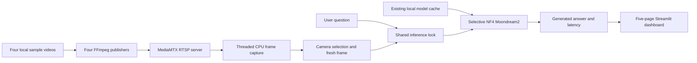

# VLM-Edge

A local multi-camera visual question-answering prototype for a B.Tech final-year project, using pretrained Moondream2 and selective 4-bit NF4 quantization on a memory-constrained NVIDIA GPU.

**Checkout status (31 October 2026):** the five-page dashboard starts and has been checked with CPU/mock tests and an offline browser at desktop and phone widths. Live RTSP/GPU execution was not repeated during this redesign. See [camera integration and startup report](CAMERA_INTEGRATION_REPORT.md) and [dashboard verification](DASHBOARD_REDESIGN.md) for current checks and [the earlier repository audit](GITHUB_PREPARATION.md) for historical preparation findings.

## Overview and motivation

The project explores natural-language inspection of camera images on a laptop GPU rather than requiring a large inference server. Its intended use is warehouse-oriented research and demonstration. Supplied demo imagery depicts a stylized forest, not a labelled warehouse dataset. Generated answers require human review and must not drive safety decisions.

The problem is to capture multiple camera streams while fitting a vision-language model within limited GPU memory. Objectives are to separate CPU video capture from on-demand GPU inference, preserve the exact submitted visual evidence, quantify inference costs, and prepare a defensible evaluation process. The project uses pretrained weights; no model training or fine-tuning is claimed.

## Implemented components and status

- Four configured RTSP endpoints with threaded capture, freshness checking and reconnect logic in `src/camera_capture.py`.
- Latest-frame selection and BGR-to-RGB conversion in `src/live_camera.py`; the frame is fetched after the shared inference lock is acquired.
- Process-cached local Moondream2 loading and serialized image encoding/answer generation in `src/model_inference.py`.
- Linux demo process management for MediaMTX, four looping FFmpeg publishers and optional Streamlit startup.
- Benchmark CSV readers, binary/count metrics, manifest validation, an approval-gated evaluation runner and a warehouse annotation tool.
- Five-page navigation: Overview, Live Monitoring, AI Assistant, Performance and Settings. Camera previews refresh independently; the live Assistant uses the existing latest-frame backend. Saved-image and evaluation tools remain in source without adding them to the monitoring navigation.
- Tests include mocks, Streamlit AppTest, concurrency, stale-frame handling, metric policies and annotation workflows. Current test outcomes are recorded in the audit, not inferred from earlier pass counts.

**Incomplete:** a genuine warehouse dataset is absent, and accuracy/counting performance has not been measured. A clean installation and current live/GPU execution are unverified.

## System architecture



This diagram describes the application architecture; current live/GPU operation still requires verification on the target host. Four camera decoders do not imply four concurrent model calls.

## Technology stack

| Component | Role |
|---|---|
| Python, Streamlit | Application and UI components |
| Moondream2, Transformers | Pretrained visual question answering |
| PyTorch, CUDA, bitsandbytes, Accelerate | GPU execution and selective quantized loading |
| OpenCV, Pillow, NumPy | RTSP decoding and image conversion |
| FFmpeg, MediaMTX | Looping video publishers and RTSP routing |
| pandas, Altair | Existing benchmark/analytics views |
| pytest, Streamlit AppTest | CPU/mock automated verification |
| NVIDIA NVML Python bindings | Legacy benchmark/telemetry scripts |

## Moondream2 and selective NF4 quantization

The configured model identifier is `vikhyatk/moondream2`. The inference code encodes an RGB image with `encode_image`, then passes the question to `answer_question`. The evaluation runner also supports the cached revision's native `query` API for explicit generation settings. This repository supplies application code, not model weights.

The loader configures `load_in_4bit=True`, NF4 quantization, FP16 quantized compute, BF16 model dtype, `device_map="auto"`, and skips `vision` and `region`. NF4 reduces storage for selected linear weights; it does not make every parameter or activation four-bit. A runtime check rejects quantized vision layers. Historical evidence recorded 97 four-bit layers and no quantized vision/region layers. These are observations from that run, not guarantees for any model revision.

Loading requires locally cached files (`local_files_only=True`) and uses `trust_remote_code=True`. Review model code and licensing before provisioning a cache. The dashboard accepts `VLM_EDGE_MODEL_REVISION` before startup; unset, it retains cached-main behavior. Explicit loader revisions take precedence; the evaluation runner pins `5d6c926f44e26b07957b0dd315bbedcb4c17a5fe`. Set the deployment revision and cache location before launch and restart after changing them. Cache contents are part of application reproducibility. No automatic weight download or provisioning command is supplied here because this preparation did not validate one.

## Repository structure

```text
app.py                         Five-page dashboard and sidebar navigation
src/
  camera_capture.py            Threaded capture and freshness handling
  live_camera.py               Camera configuration and latest-frame Q&A
  live_camera_ui.py            Shared previews, live Assistant and request history
  model_inference.py           Cached selective NF4 inference and locking
  benchmark_metrics.py         Latency, binary and counting metrics
  data_loader.py               Saved-frame and benchmark CSV loading
  evaluation_manifest.py       Labelled manifest validation
  evaluation_runner.py         Planned/approved evaluation execution
  warehouse_annotation.py      Annotation and provenance support
  ui.py, views/                Central CSS and dashboard views
  pages/                       Thin native Streamlit page entrypoints
config/
  cameras.json                 Four local RTSP endpoints
  mediamtx-demo.yml             Loopback-only TCP RTSP server configuration
tools/                         Demo lifecycle, annotation, evaluation, verification
.streamlit/config.toml         UI/server settings
evaluation/                    Blank manifest and description-review templates
data/warehouse_pilot/          Empty pilot scaffold, guides and quality records
test_frames/                   Twelve byte-identical demo JPEGs; rights review needed
sample_videos/                 cam1.mp4 ... cam4.mp4 (local, Git-ignored)
verification/                  Historical live-demo JSON and submitted image
start_demo.sh, stop_demo.sh     Linux demo wrappers
requirements.txt, pytest.ini   Direct dependency pins and test discovery config
benchmark_baseline.py           Historical RTSP FP16 benchmark
benchmark_quant.py              Historical saved-image NF4 benchmark
capture_frames.py, telemetry.py Legacy capture/telemetry utilities
quantize_model.py               Separate legacy Qwen/AWQ experiment
zero_copy_bench.cu              Separate CUDA experiment
*.csv, *report*.txt             Historical results; not accuracy labels
EVALUATION.md                   Manifest schema and evaluation policy
BENCHMARK_PROTOCOL.md           Controlled benchmark preparation
```

Virtual environments and retained runtime evidence are ignored. Disposable backups, caches and audit/browser temp directories were removed during cleanup. The separate Qwen/AWQ script is not part of the Moondream2 workflow and its `awq` dependency is intentionally outside the main requirements.

## Prerequisites and hardware

The historically exercised target is WSL2 Ubuntu, Python 3.11, CUDA-enabled PyTorch 2.6.0+cu124 and an NVIDIA RTX 3050 Laptop GPU with about 4 GiB VRAM. This is the tested historical target, not a demonstrated minimum hardware specification. CPU-only model inference and other GPU configurations have not been validated. Allow sufficient host memory/disk for the environment and externally provisioned model cache; exact minimums were not measured.

Install or provide Python 3.11 with venv support, a compatible NVIDIA Windows/WSL driver, Git, FFmpeg/ffprobe with libx264, and MediaMTX. Confirm `nvidia-smi`, `ffmpeg -version` and `ffprobe -version` in WSL before attempting a demo. MediaMTX is an external executable; its version is not pinned in this repository. The lifecycle helper uses Linux `/proc`, `fcntl` and process groups and is not a native Windows launcher.

## Environment setup and dependencies

For a clean install on the GPU laptop, use [DEPLOYMENT_GUIDE.md](DEPLOYMENT_GUIDE.md). It separates current-host checks from new-laptop verification.

Run commands from the actual repository root in WSL; the historical location was `~/vlm-edge`. The Windows working copy used for preparation is a different location. Do not reuse copied virtual environments whose interpreters reference another machine.

For an intact existing Python 3.11 environment, inspect it first and preserve the working AI stack:

```bash
source venv/bin/activate
python --version
python -m pip show torch transformers bitsandbytes accelerate streamlit opencv-python
python -m pip check
```

For a new environment, the following is the installation recipe derived from source imports and copied package metadata. **It has not been clean-install tested.** It requires Python 3.11 and availability of the exact pinned distributions. Stop on resolution errors rather than upgrading the AI stack implicitly.

```bash
python3.11 -m venv venv
source venv/bin/activate
python -m pip install torch==2.6.0+cu124 --index-url https://download.pytorch.org/whl/cu124
python -m pip install -r requirements.txt
python -m pip check
```

`requirements.txt` pins direct application, evaluation and test dependencies recovered from the copied WSL metadata. It is not a transitive lockfile and does not provision system executables or weights. `nvidia-ml-py` supplies the legacy `pynvml` import; the copied environment also contains the deprecated `pynvml` distribution. No installed package was replaced in preparation. The available Windows Python 3.14 environment differs substantially and is not the validated GPU target.

## Starting the application

The entrypoint now opens Overview. The five navigation pages use the existing capture manager and inference cache. A local HTTP/browser startup was verified; target WSL/GPU startup still depends on a valid environment, local model cache and external streams.

Dashboard only (external streams must already be available):

```bash
source venv/bin/activate
python -m streamlit run app.py
```

Stop with Ctrl+C. Start capture in Live Monitoring, then open AI Assistant, select a camera with a fresh frame, type a nonempty question, and click Ask AI. The backend validates freshness, loads the cached model, acquires the inference lock, takes the latest frame, converts it to RGB and generates an answer. No automatic inference on every decoded frame is implemented. Only one dashboard process should own the model on a 4 GiB GPU.

### Camera demo lifecycle

Provide permitted `sample_videos/cam1.mp4` through `cam4.mp4` locally; they are deliberately excluded from Git. The helper defaults to `~/mediamtx/mediamtx`, or accepts `MEDIAMTX_BIN`:

```bash
export MEDIAMTX_BIN=/actual/path/to/mediamtx
bash start_demo.sh
venv/bin/python tools/demo_runtime.py status
bash stop_demo.sh
```

Replace `/actual/path/to/mediamtx` with the installed executable. `start_demo.sh` launches MediaMTX, four publishers and the dashboard on port 8501. Dashboard binding is loopback `127.0.0.1`. Logs/PID records are under `.runtime/`. Startup preflight checks tools/sources/ports first; a later failure stops only processes newly created by that attempt. Use `bash stop_demo.sh` for helper-owned processes. It does not stop unrelated processes.

To start streams without the dashboard:

```bash
venv/bin/python tools/demo_runtime.py start
venv/bin/python tools/demo_runtime.py status
venv/bin/python tools/demo_runtime.py stop
```

The helper probes each local codec. The current H.264 files use stream copy; other codecs retain the libx264 fallback. The source-checked H.264 command pattern for cam1 is:

```bash
ffmpeg -nostdin -hide_banner -loglevel warning -re -stream_loop -1 \
  -i sample_videos/cam1.mp4 -map 0:v:0 -an -c:v copy \
  -f rtsp -rtsp_transport tcp rtsp://127.0.0.1:8554/cam1
```

This requires MediaMTX already running with `config/mediamtx-demo.yml`. The helper uses this pattern for all four cameras. Do not run duplicate publishers while the helper owns them. Configured endpoints are `rtsp://127.0.0.1:8554/cam1` through `/cam4`. Probe each independently:

```bash
ffprobe -v error -rtsp_transport tcp -i rtsp://127.0.0.1:8554/cam1 \
  -show_entries stream=codec_name -of default=nw=1
```

A codec response verifies only that endpoint at that moment, not answer correctness or current dashboard behavior. Commands are source-checked; no publishers or GPU workloads were launched during preparation.

## Evaluation methodology

See [EVALUATION.md](EVALUATION.md), [BENCHMARK_PROTOCOL.md](BENCHMARK_PROTOCOL.md) and the [warehouse pilot guide](data/warehouse_pilot/ANNOTATION_GUIDE.md).

1. Obtain permitted representative warehouse images. Record source, scene/session grouping, permission and human annotation provenance. Separate related scenes across dataset splits to reduce leakage.
2. Create genuine human-reviewed binary, counting and description references using the [blank manifest](evaluation/manifest_template.csv). Do not treat model answers or synthetic test fixtures as labels.
3. Validate a populated manifest before planning inference. The supplied blank template intentionally fails validation:

   ```bash
   venv/bin/python tools/evaluate.py validate evaluation/manifest_template.csv
   ```

4. For binary questions, report accuracy, precision, recall, F1, confusion matrix and invalid-response rate using the documented strict yes/no parser. Invalid answers count as incorrect.
5. For counting, report exact-match accuracy, valid-only MAE with its denominator, and invalid rate. Descriptions require independent human factuality, coverage, hallucination and uncertainty review; no automatic semantic accuracy is provided.
6. Freeze dataset hashes, model revision, generation settings and source versions. The evaluation runner requires a reviewed plan and matching explicit approval record before real execution; preparation creates no approval.
7. Measure CUDA-synchronized image encoding plus generation. Report loading/cold behavior separately from warmed requests. Exclude capture/decode and lock wait from inference latency; measure a separate camera-to-answer metric for an end-to-end claim.
8. For controlled GPU-memory experiments, reset/read PyTorch peak allocation around a defined workload and label MiB. Report system/NVML memory separately. Never compare unlike memory measurements as a reduction percentage.

## Recorded results and evidence boundaries

These are existing artifacts inspected during preparation, **not rerun results**:

| Evidence | Recorded observation | Interpretation |
|---|---|---|
| [Saved-image GPU smoke](qa_gpu_smoke_20261029T162400437910Z.json) and [Task 1 record](TASK1_VERIFICATION.md) | 97 quantized layers; 2420.71 MiB peak PyTorch allocation; first request 10179.8 ms; subsequent request 1007.6 ms | Two different questions/images; first request not warmed. Not a controlled speed comparison or end-to-end latency. |
| [Later saved-image smoke](qa_gpu_smoke_20261029T195443338053Z.json) | 6606.30 ms and 1163.59 ms; one model load/cache reuse | Separate historical requests; no accuracy score. |
| [Live-demo record](verification/live-demo-20261030T051828372533Z.json) | Four decoded streams with 20-21 distinct frames; offline rejection/reconnection; one cam1 answer at 6690.32 ms; peak 2420.71 MiB | Historical script evidence for capture and latest-frame inference, not current UI validation or warehouse accuracy. Record labels submitted source `unverified_rtsp`. |

Historical baseline/quantized CSVs contain eight measured frames per run. Baseline captures RTSP frames while quantized runs use saved images; exact image equivalence is not established. Baseline system-level memory and quantized PyTorch peak allocation differ in measurement method. Power samples are sparse. No defensible memory/power reduction, accuracy percentage, tokens-per-second result or performance superiority is claimed.

## Tests and current development status

In a working original-stack environment, run CPU/mock verification without downloading weights:

```bash
HF_HUB_OFFLINE=1 TRANSFORMERS_OFFLINE=1 PYTHONDONTWRITEBYTECODE=1 \
  venv/bin/python -m pytest -q -p no:cacheprovider -p tools.pytest_cpu_guard
```

The guard rejects real model/tokenizer loads and CUDA initialization. Do not execute standalone benchmark, quantization or GPU smoke scripts as part of repository preparation. Earlier saved-Q&A smoke tooling targets an earlier dashboard and needs review before reuse. Current UI results and environment differences are in [DASHBOARD_REDESIGN.md](DASHBOARD_REDESIGN.md); earlier repository preparation and test counts are historical.

## Known limitations

- Current browser verification used offline streams; real camera-to-answer operation must be rechecked on the intended GPU host.
- Model cache provisioning and a fresh environment still require target-laptop verification; use an explicit deployment revision.
- Capture is multi-camera, but inference is synchronous and serialized within one process. Separate processes can allocate separate models; there is no cross-process dashboard lock or cancellation.
- Receipt timestamps/freshness are not sensor capture timestamps or full network latency measurements.
- No genuine permitted warehouse dataset, human-verified labels or measured warehouse accuracy exists.
- Demo streams are prerecorded loops. Successful demo capture does not establish real surveillance robustness.
- Moondream2 can hallucinate and miscount. Quantization may affect answers and requires controlled quality assessment.
- Media provenance/redistribution rights and project licensing remain unresolved; no licence grant is invented here.

## Future improvements

Verify the redesigned UI with real streams and GPU inference, pin/review cached model code, validate a clean Python 3.11 installation, document exact external tool versions, obtain permitted representative data, complete independent annotations, and run approved controlled accuracy/latency/memory experiments. Longer-term work may assess queueing, operational robustness and deployment hardware; none is presented as implemented evidence.

## Academic attribution and redistribution

VLM-Edge is a B.Tech final-year academic project. Author, supervisor, institution and academic year should be added by the project owner; no identities are assumed. Moondream2 and third-party libraries remain the work of their respective authors. Review the exact model snapshot's terms, FFmpeg/MediaMTX distribution terms and demo-media permissions before redistribution. No repository LICENSE is currently supplied. Test images and historical evidence containing imagery remain subject to provenance review before public staging.
